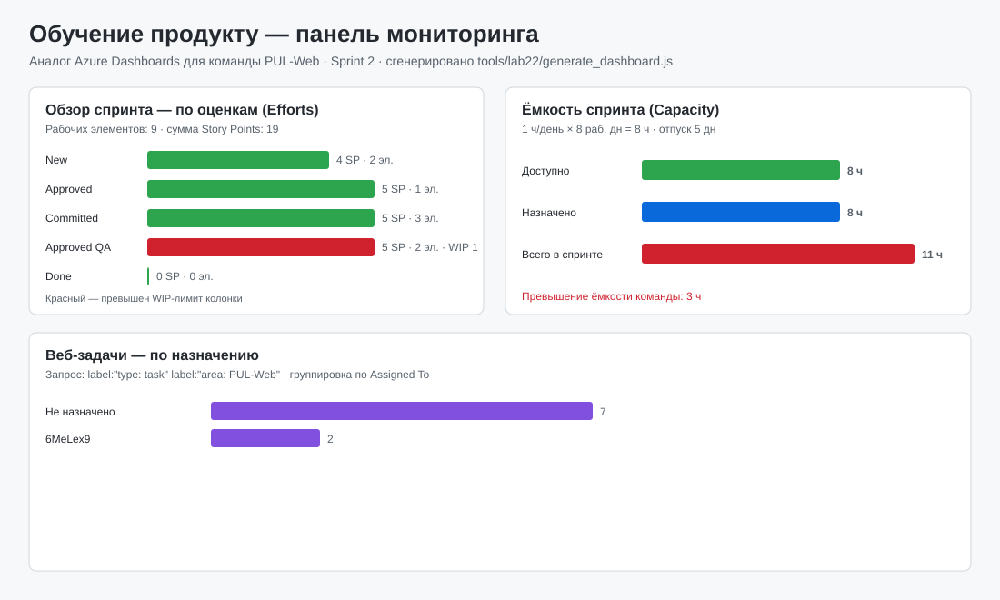

# Панель мониторинга «Обучение продукту» (ЛР 2.2, Задача 5)

Сгенерирована из текущего состояния доски скриптом `tools/lab22/generate_dashboard.js`.
Виджеты повторяют плитки Azure Dashboards: **Sprint Overview** (по оценкам), **Sprint Capacity**
и диаграмму запроса «Веб-задачи» по исполнителю.

## Данные, попавшие на панель

| Показатель | Значение |
| --- | --- |
| Спринт | Sprint 2 |
| Рабочих элементов в спринте | 9 |
| Сумма Story Points | 19 |
| Ёмкость (1 ч × 8 дн) | 8 ч |
| Назначенная оставшаяся работа | 8 ч |
| Всего оставшейся работы в спринте | 11 ч |
| Превышение ёмкости | 3 ч |

## Распределение по колонкам

| Колонка | Элементов | Story Points | WIP-лимит | Состояние |
| --- | --- | --- | --- | --- |
| New | 2 | 4 | — | ок |
| Approved | 1 | 5 | — | ок |
| Committed | 3 | 5 | — | ок |
| Approved QA | 2 | 5 | 1 | **превышен** |
| Done | 0 | 0 | — | ок |

## Распределение по исполнителям

| Кому назначено | Задач |
| --- | --- |
| Не назначено | 7 |
| 6MeLex9 | 2 |

## Как это соотносится с Azure

| Виджет Azure | Реализация |
| --- | --- |
| Sprint Overview (режим Efforts) | поле `Story Points` + разбивка по `Board Column` |
| Sprint Capacity | `Remaining Work` против ёмкости из `lab2.1-board.json` |
| Query «Веб-задачи» → Diagram (Assigned To) | фильтр `label:"type: task"` + группировка по `Assignees` |

> Диаграммы Project v2 (Insights) создаются только в браузере; здесь панель
> сгенерирована из тех же данных, что видны на доске, поэтому её можно
> перегенерировать в любой момент одной командой.
